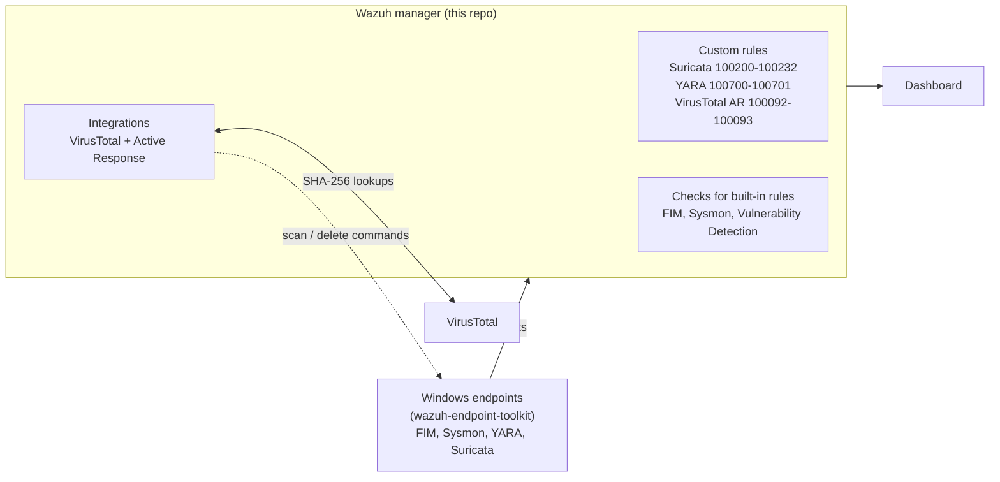

# Wazuh Manager Toolkit

-3595F7)


**Manager-side** (Linux) companion to
[wazuh-endpoint-toolkit](https://github.com/TanZero7/wazuh-endpoint-toolkit):
custom detection rules, integrations and verification scripts for a Wazuh
SIEM, one folder per capability. Everything that runs on Windows endpoints lives
in the endpoint repo; everything here runs on the Wazuh manager.

## Where this fits



## Capabilities

| Folder | Type | What it does |
|---|---|---|
| [suricata](suricata) | **install (required)** | Custom rules 100200–100232 that turn Suricata's DNS/TLS/HTTP events into searchable visibility alerts (Wazuh's stock rules discard them at level 0) |
| [yara](yara) | **install** | Rules 100700/100701 for YARA scan results + the `ossec.conf` active-response block that triggers the scan on every FIM change |
| [virustotal](virustotal) | **install** | Official VirusTotal hash-reputation integration, optional Active Response (auto-delete on a positive), and rules 100092/100093 for clear AR outcome alerts |
| [fim](fim) | verify only | Confirms Wazuh's built-in FIM rules (550/553/554) are present |
| [sysmon](sysmon) | verify only | Confirms Wazuh's built-in Sysmon ruleset (~150 rules) is present |
| [vulnerability-detection](vulnerability-detection) | verify / diagnose | Checks the built-in CVE module is enabled and producing data, with a step-by-step diagnosis path for agents that "look empty" |

## Detection coverage

Custom rules shipped in this repo (built-in Wazuh rules for FIM, Sysmon and
vulnerability detection are verified, not modified).

| Rule | Level | Detects | MITRE ATT&CK |
|---|---|---|---|
| 100200 / 100201 / 100202 | 12 / 7 / 4 | Suricata IDS signature hit, by severity (high / medium / low) | per signature |
| 100205 | 10 | 8+ IDS alerts from one source in 60 s: scan or sustained attack | - |
| 100211 | 8 | Possible DNS tunnelling (abnormally long DNS label) | [T1071.004](https://attack.mitre.org/techniques/T1071/004/), [T1048.003](https://attack.mitre.org/techniques/T1048/003/) |
| 100212 | 5 | DNS query to a frequently abused TLD | - |
| 100221 | 4 | TLS connection with no SNI | - |
| 100231 | 7 | Executable or archive downloaded over cleartext HTTP | [T1105](https://attack.mitre.org/techniques/T1105/) |
| 100232 | 6 | Scripted HTTP client (curl, PowerShell, python-requests…) | [T1071.001](https://attack.mitre.org/techniques/T1071/001/) |
| 100210 / 100220 / 100230 | 3 | DNS / TLS / HTTP visibility events (searchable network telemetry) | - |
| 100700 | 12 | YARA rule matched on a file FIM saw change | [T1204.002](https://attack.mitre.org/techniques/T1204/002/), [T1059](https://attack.mitre.org/techniques/T1059/) |
| 100701 | 3 | YARA scan completed, no match (audit trail) | - |
| 100092 / 100093 | 12 | VirusTotal active response removed a threat / failed to remove it | - |

## How to deploy

**Always: manager side first (this repo) → endpoint side → verify from the endpoint.**

1. **[guides/MANAGER-SETUP-GUIDE.md](guides/MANAGER-SETUP-GUIDE.md)**: every manager step in order, with the expected `[ OK ]` output.
2. Then the endpoint guides in
   [wazuh-endpoint-toolkit → guides](https://github.com/TanZero7/wazuh-endpoint-toolkit/tree/main/guides),
   which end with the verification steps.

Only need one capability? Each folder has a README and an `INTEGRATION-GUIDE.md`
covering just that capability's manager side, ending with a **Next →** link to its
endpoint folder.

```bash
git clone https://github.com/TanZero7/wazuh-manager-toolkit.git
cd wazuh-manager-toolkit/<capability>
sudo bash <script>.sh
```

## How the scripts behave

- **Back up first.** Anything that touches `/var/ossec/etc` saves a timestamped
  copy under `/var/ossec/backup/` before changing it.
- **Validate before restart.** Rule installers validate with `wazuh-logtest`
  against sample events, or `wazuh-analysisd -t`, *before* restarting the manager,
  because a malformed rules file stops `wazuh-manager` from starting at all.
- **`ossec.conf` edits are deliberately conservative.** The YARA active-response
  block is pasted by hand (`active-response-block.xml` explains why). The
  VirusTotal scripts edit `ossec.conf` automatically but config-test with
  `wazuh-analysisd -t` and refuse to restart on a failure.
- **Safe to re-run.** Installers are idempotent.

## Requirements

- Wazuh manager 4.x (tested with 4.14), `sudo` access
- Internet access from the manager for VirusTotal lookups and CVE feed updates
- A VirusTotal API key (for `virustotal/` only)

## License

See [LICENSE](LICENSE). Release history: [CHANGELOG.md](CHANGELOG.md).
