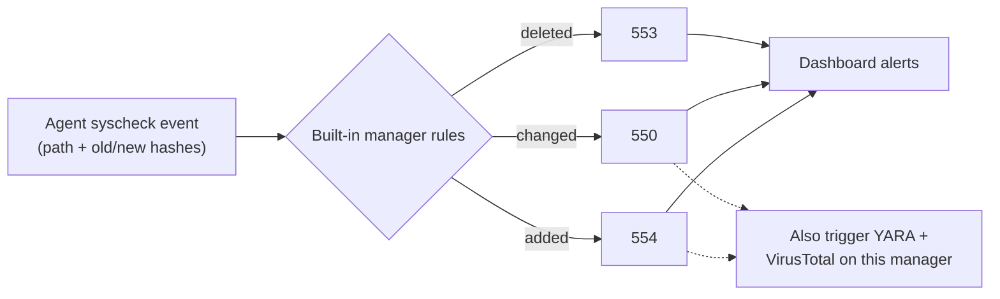

# FIM: manager-side check

> **Order:** do this manager side **first** → then the endpoint side, [wazuh-endpoint-toolkit → fim](https://github.com/TanZero7/wazuh-endpoint-toolkit/tree/main/fim) → then verify from the endpoint.
> Step-by-step with expected `[ OK ]` output: **[INTEGRATION-GUIDE.md](INTEGRATION-GUIDE.md)**.

## What is FIM, and what does the manager do?

**File Integrity Monitoring** fingerprints files (hashes, size, owner) on each
endpoint and reports any file **added, changed or deleted** in Desktop and
Downloads. The agent does the watching; the **manager turns those reports into
alerts** using Wazuh's built-in rules. Full explanation:
[endpoint fim → What is FIM?](https://github.com/TanZero7/wazuh-endpoint-toolkit/tree/main/fim#what-is-fim).



Nothing custom is installed here; the check below just proves those built-in
rules are present and the analysis engine is running.

---

## Details

Nothing to install. Wazuh's **built-in** FIM rules (550 modified, 553 deleted,
554 added) handle alerting out of the box. This script confirms that's actually
true on your manager (a stripped-down or heavily customized ruleset is the only
case where it wouldn't be).

```bash
sudo bash check-fim-rules.sh
```

**Next →** [wazuh-endpoint-toolkit → fim](https://github.com/TanZero7/wazuh-endpoint-toolkit/tree/main/fim)
