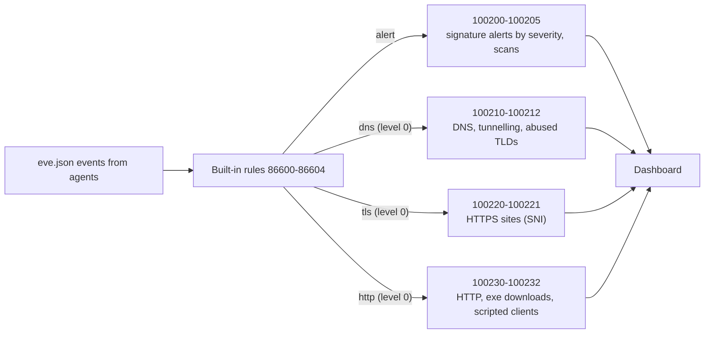

# Suricata: manager-side visibility rules

> **Order:** do this manager side **first** → then the endpoint side, [wazuh-endpoint-toolkit → suricata](https://github.com/TanZero7/wazuh-endpoint-toolkit/tree/main/suricata) → then verify from the endpoint.
> Step-by-step with expected `[ OK ]` output: **[INTEGRATION-GUIDE.md](INTEGRATION-GUIDE.md)**.

## What is Suricata, and what does the manager do?

**Suricata** is an open-source network IDS. On each endpoint it inspects network
traffic against ~52,000 Emerging Threats signatures and logs every DNS lookup,
TLS connection and HTTP request to `eve.json`, which the agent forwards. Full
explanation: [endpoint suricata → What is Suricata?](https://github.com/TanZero7/wazuh-endpoint-toolkit/tree/main/suricata#what-is-suricata).

**Why this manager side is required:** Wazuh's built-in Suricata rules keep
signature alerts but rate DNS, TLS and HTTP events **level 0, meaning decode and
discard**. These custom rules sit on top of the built-in ones and keep that
traffic, graded by importance:



Without this step: intrusion alerts only, and **no network visibility at all**.

---

## Details

**Required** for the Suricata endpoint IDS to be useful. Wazuh's built-in Suricata
rules for DNS, TLS and HTTP are level 0 ("decode then discard"), so without these
custom rules you get signature alerts and no network visibility at all.

| File | Purpose |
|---|---|
| `local_rules_suricata.xml` | custom rules 100200–100232: signature alerts by severity, DNS queries (100210), DNS-tunnelling heuristics (100211), abused TLDs (100212), TLS SNI (100220), HTTP (100230), executables or archives over cleartext HTTP (100231), scripted clients (100232) |
| `install-manager-rules.sh` | prints the manager version, backs up, installs, validates with `wazuh-logtest` **before** restarting, then restarts and confirms the manager came back |

## Install

```bash
sudo bash install-manager-rules.sh
```

The version it prints matters: the Windows agent must be **no newer** than the
manager. If it is, run `01-fix-agent-version.ps1` from the endpoint toolkit.

> The installer's `wazuh-logtest` self-check looks for sample events in
> `logtest-samples/`. Those aren't part of this release, so it warns and skips
> validation. Verify from the endpoint side instead (`05-verify.ps1`, then
> `rule.groups:suricata` in the dashboard).

## Useful queries

| Query | Shows |
|---|---|
| `rule.groups:suricata` | everything from this integration |
| `rule.id:100220` | every HTTPS site visited (TLS SNI) |
| `rule.id:100210` | every domain resolved |
| `rule.level:>=7` | only things worth investigating |

**Next →** [wazuh-endpoint-toolkit → suricata](https://github.com/TanZero7/wazuh-endpoint-toolkit/tree/main/suricata)
