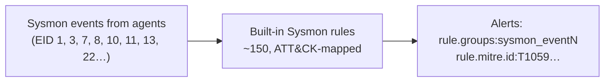

# Sysmon: manager-side check

> **Order:** do this manager side **first** → then the endpoint side, [wazuh-endpoint-toolkit → sysmon](https://github.com/TanZero7/wazuh-endpoint-toolkit/tree/main/sysmon) → then verify from the endpoint.
> Step-by-step with expected `[ OK ]` output: **[INTEGRATION-GUIDE.md](INTEGRATION-GUIDE.md)**.

## What is Sysmon, and what does the manager do?

**Sysmon** is a Microsoft Sysinternals driver + service that logs detailed
process, network, file and registry activity on each Windows endpoint. The agent
forwards those events; the **manager's built-in Sysmon ruleset (~150 rules)**
decides which are suspicious and tags them with MITRE ATT&CK techniques. Full
explanation: [endpoint sysmon → What is Sysmon?](https://github.com/TanZero7/wazuh-endpoint-toolkit/tree/main/sysmon#what-is-sysmon).



Nothing custom is installed here; the check below confirms the ruleset is present.

---

## Details

Nothing to install. Wazuh's **built-in** Sysmon ruleset (~150 rules across event
IDs 1, 3, 7, 8, 10, 11, 13, 20) does the detection. This script confirms the
expected rule files are present and `wazuh-analysisd` is running.

```bash
sudo bash check-sysmon-rules.sh
```

**Next →** [wazuh-endpoint-toolkit → sysmon](https://github.com/TanZero7/wazuh-endpoint-toolkit/tree/main/sysmon)
