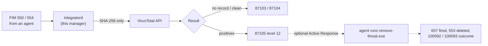

# VirusTotal: Hash Reputation (+ optional Active Response)

Adds Wazuh's **standard, official** VirusTotal integration — hash reputation
lookups on every FIM-detected file change. No custom rules or decoders
needed; Wazuh ships full support for this out of the box, this folder just
automates the one config block Wazuh's own documentation asks you to add,
safely (backup, config-test, then restart).

Also includes an **optional Active Response** add-on: auto-delete a file the
moment VirusTotal reports it malicious, instead of just alerting on it. See
"Active Response (optional)" below — this part needs both server and
endpoint pieces, not server-only.

## What is VirusTotal, and what does the manager do?

**VirusTotal** checks a file's hash against ~70 antivirus engines. This runs
entirely **from the manager**: Wazuh's built-in `integratord` sends the
SHA-256 of every file FIM reports (never the file itself) and raises an alert on
positives. Optional **Active Response** then tells the agent to delete the file.
Endpoint half and full walkthrough:
[endpoint virustotal-active-response](https://github.com/TanZero7/wazuh-endpoint-toolkit/tree/main/virustotal-active-response#what-is-virustotal-and-what-is-active-response).



---

## Start here

| If you want to... | Read |
|---|---|
| **Deploy this from scratch** | **[INTEGRATION-GUIDE.md](INTEGRATION-GUIDE.md)** |

## Folder layout

```
README.md
INTEGRATION-GUIDE.md                   full deployment + troubleshooting guide
add-virustotal-integration.sh          <- alert-only, start here
add-virustotal-active-response.sh      <- optional: auto-delete on positive
local_rules_virustotal.xml             <- optional: AR outcome alerts (100092/100093)
install-manager-rules.sh               <- installs the rules file above
```

The endpoint half of Active Response (`remove-threat.exe` + its installer) lives in
`virustotal-active-response/` of
[wazuh-endpoint-toolkit](https://github.com/TanZero7/wazuh-endpoint-toolkit).

## Install

```bash
sudo bash add-virustotal-integration.sh <YOUR_VIRUSTOTAL_API_KEY>
```

Requires a VirusTotal API key (free or paid; see the rate-limit note below).

## Active Response (optional): auto-delete instead of alert-only

By default this integration only alerts (rule 87105) — a human still has to
see it and remove the file by hand. Active Response closes that loop: on a
positive VirusTotal verdict, the manager tells the agent to run
`remove-threat.exe`, which deletes the file (confirmed live: `554` file
added → `87105` VirusTotal positive → `657` Active Response fired →
`553` file deleted).

1. **Server** (once): `sudo bash add-virustotal-active-response.sh`
2. **Server, optional but recommended** (once): `sudo bash install-manager-rules.sh`
   — installs rules 100092/100093, which turn the generic "Active response
   fired" alert (657) into a clear success/failure alert with the file path
   included. Straight from Wazuh's own official documentation.
3. **Endpoint** (per machine): `install-active-response.ps1` from
   `virustotal-active-response/` in
   [wazuh-endpoint-toolkit](https://github.com/TanZero7/wazuh-endpoint-toolkit).
   It deploys `remove-threat.exe` (build it once; see that folder's README) to
   the agent's `active-response\bin\` folder.

Skip this whole section to keep VirusTotal alert-only, which is a
perfectly reasonable choice — Active Response deletes files automatically
and irreversibly, so make sure that's actually what you want before wiring
it up fleet-wide.

## Known limitations

- Requires internet access from the manager to `virustotal.com` at scan
  time — if that's down, this layer goes dark.
- Free-tier VirusTotal API keys have a request-rate limit; paid plans do not have the same constraint, but keep it in mind if this
  is ever run against a free key.
