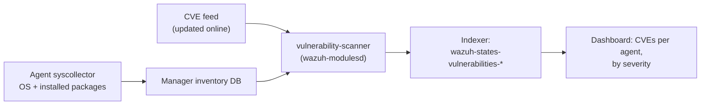

# Vulnerability Detection: Verification

Wazuh's Vulnerability Detection module — CVE matching against installed
software/OS inventory — ships built in. This isn't something to install; it's
something to **confirm is enabled and actually producing results**, and to
have a clear diagnosis path for when an agent's coverage "looks empty."

An initial deployment review flagged this as *"partially active,
inconsistent across agents"* and asked for investigation. On the one
production agent tested during this build, it was found to be **working
correctly** (148 CVEs indexed within about an hour of enrollment) — the
concern didn't reproduce. This check exists so that if it *does* show
up as a real problem on another agent later, there's a fast, structured way
to diagnose it instead of starting from scratch.

## What is Vulnerability Detection?

Every Wazuh agent runs **syscollector**, which inventories the machine's
operating system and installed software (names and versions). The manager's
**Vulnerability Detection** module compares that inventory against a CVE feed
(published vulnerabilities) and records which CVEs affect each agent, with
severity and CVSS score, in the indexer. The dashboard's *Vulnerability
Detection* page then shows, per machine, what needs patching.



### Why a SOC cares

- **Most breaches use known, already-patched vulnerabilities.** This gives a
  continuously updated list of which machines are exposed, without a separate
  scanner. *ATT&CK: T1190 Exploit Public-Facing Application, T1068
  Exploitation for Privilege Escalation.*
- **Prioritise by severity:** sort by CVSS/critical to decide what to patch first.
- **No agents to add:** it uses inventory the Wazuh agent already collects.

It ships built in, so this folder doesn't install anything: it checks that the
module is enabled and producing data, and gives a step-by-step diagnosis when an
agent's list looks empty.

---

## Start here

| If you want to... | Read |
|---|---|
| **Verify / troubleshoot this** | **[INTEGRATION-GUIDE.md](INTEGRATION-GUIDE.md)** |

## Folder layout

```
README.md
INTEGRATION-GUIDE.md
check-vulnerability-detection.sh
```

## Verify

```bash
sudo bash check-vulnerability-detection.sh
```

## Known limitations

- Feed updates need internet access from the manager — a manager with none
  will fall behind on new CVEs even if everything else is working.
- Detection quality depends entirely on syscollector's package/OS inventory
  being current — an agent that isn't reporting inventory won't show
  vulnerabilities even with the module fully healthy.
