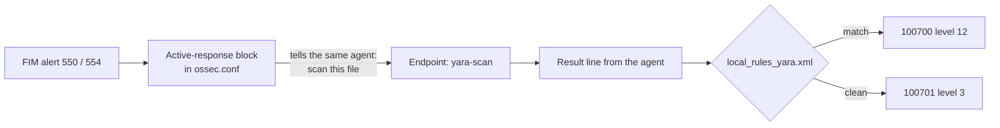

# YARA: manager-side rules + active-response wiring

> **Order:** do this manager side **first** → then the endpoint side, [wazuh-endpoint-toolkit → yara](https://github.com/TanZero7/wazuh-endpoint-toolkit/tree/main/yara) → then verify from the endpoint.
> Step-by-step with expected `[ OK ]` output: **[INTEGRATION-GUIDE.md](INTEGRATION-GUIDE.md)**.

## What is YARA, and what does the manager do?

**YARA** is the malware analyst's pattern-matching tool: rules describe strings
and byte patterns found in malware families, so it catches **variants** a hash
check would miss. The scan itself runs on the endpoint; the **manager decides
when to scan and turns results into alerts**. Full explanation:
[endpoint yara → What is YARA?](https://github.com/TanZero7/wazuh-endpoint-toolkit/tree/main/yara#what-is-yara).



The manager owns two pieces: the **active-response block** (the trigger) and
**rules 100700/100701** (the alerts).

---

## Details

Turns the YARA scan results the endpoint writes into Wazuh alerts, and tells the
manager to trigger the scan on every FIM add/change.

| File | Purpose |
|---|---|
| `local_rules_yara.xml` | rule **100700** (match) / **100701** (clean scan) |
| `install-manager-rules.sh` | backs up, installs and validates the rules with `wazuh-logtest` against `logtest-samples/` (restart happens after the manual step below) |
| `active-response-block.xml` | the `<command>` + `<active-response>` block to paste into `ossec.conf` **by hand** (see its header for why this stays manual) |
| `logtest-samples/` | sample match / clean events the installer uses to prove the rules fire |

## Install

```bash
sudo bash install-manager-rules.sh
```

Expect `[ OK ] yara-match.json -> rule 100700`. Then paste
`active-response-block.xml` into `/var/ossec/etc/ossec.conf`, run
`sudo /var/ossec/bin/wazuh-analysisd -t`, and only if that's clean,
`sudo systemctl restart wazuh-manager`.

> **Bug fixed in this version:** rule 100700 must use `\.+` (OS_Regex for "any
> value"). An earlier "fix" changed it to `.+`, which in OS_Regex matches literal
> dots only, so real matches never alerted. If that copy is installed, re-run
> `install-manager-rules.sh` and confirm `[ OK ] yara-match.json -> rule 100700`.

**Next →** [wazuh-endpoint-toolkit → yara](https://github.com/TanZero7/wazuh-endpoint-toolkit/tree/main/yara)
